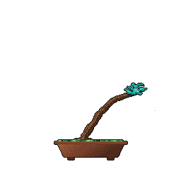
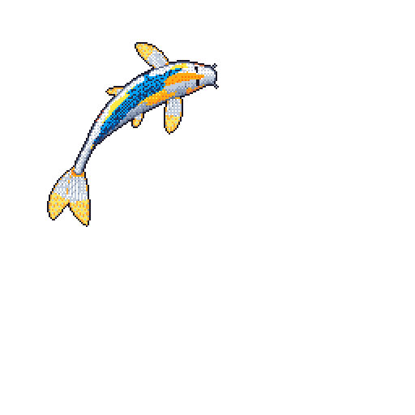

  
  <a href="https://github.com/ihsanguldur#year-list-container"><picture><source media="(prefers-color-scheme: dark)" srcset="cards/stats-dark.svg"></picture></a>

  
  <a href="https://github.com/ihsanguldur?tab=repositories"><picture><source media="(prefers-color-scheme: dark)" srcset="cards/languages-dark.svg"></picture></a>

